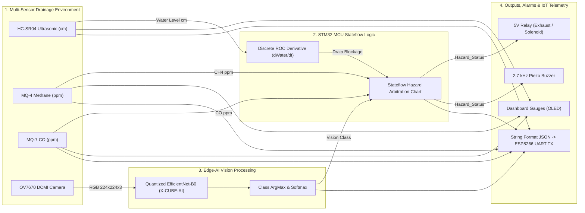

# STM32-Based Edge-AI Underground Drainage Hazard Detection System
**Custom Discrete-Time Simulation & Hardware Architecture**

This repository provides the full hardware-in-the-loop (HIL) and discrete-time simulation environment for an underground drainage monitoring unit powered by an **STM32 ARM Cortex-M4 MCU** coupled with an **Edge-AI vision pipeline (EfficientNet-B0 ONNX / ST X-CUBE-AI)**, multi-gas sensors (MQ-4 Methane, MQ-7 Carbon Monoxide), ultrasonic level sensing (HC-SR04), and IoT telemetry (ESP8266 JSON over UART).

---

## Repository Structure

| File | Description |
| :--- | :--- |
| [`simulate_system.py`](file:///home/senju/Documents/drainage-gas-hazard-system/simulate_system.py) | **Python Discrete-Time SIL Simulation Engine:** Cycle-accurate $1.0\text{ ms}$ SysTick clock, $50\text{ ms}$ sensor sampling, rate-of-change ($\text{ROC}$) calculation, Stateflow FSM with hysteresis, Edge-AI inference, and multi-panel plot export. |
| [`index.html`](file:///home/senju/Documents/drainage-gas-hazard-system/index.html) | **Interactive Real-Time Web Simulator UI:** Hardware dashboard with radial OLED gauges, live camera view, dual-trace oscilloscope, ESP8266 UART JSON terminal, and Web Audio $2.7\text{ kHz}$ buzzer. |
| [`web_simulator.py`](file:///home/senju/Documents/drainage-gas-hazard-system/web_simulator.py) | **Local Web Server:** Serves `index.html` on `http://localhost:8080/`. |
| [`stm32_firmware_sim.c`](file:///home/senju/Documents/drainage-gas-hazard-system/stm32_firmware_sim.c) | **ANSI-C Microcontroller Firmware:** Native C implementation of the SysTick interrupt loop, discrete derivative, Stateflow FSM, and UART DMA JSON serializer. |
| [`export_onnx_efficientnet.py`](file:///home/senju/Documents/drainage-gas-hazard-system/export_onnx_efficientnet.py) | **PyTorch to ONNX Exporter:** EfficientNet-B0 3-class model export stub for ST X-CUBE-AI INT8 quantization. |
| [`init_drainage_parameters.m`](file:///home/senju/Documents/drainage-gas-hazard-system/init_drainage_parameters.m) | **MATLAB Parameter Initializer:** Workspace variables, sample times, calibration constants, and synthetic camera tensors for Simulink. |
| [`build_stm32_drainage_system.m`](file:///home/senju/Documents/drainage-gas-hazard-system/build_stm32_drainage_system.m) | **Simulink Model Builder:** Programmatically generates `stm32_drainage_hazard_system.slx`, Stateflow charts, and block wiring via Simulink API. |
| [`simulation_results.png`](file:///home/senju/Documents/drainage-gas-hazard-system/simulation_results.png) | **Waveform Oscillogram:** Generated 5-panel verification plot from the discrete simulation. |
| [`uart_telemetry.log`](file:///home/senju/Documents/drainage-gas-hazard-system/uart_telemetry.log) | **UART Log:** Real-time log of the $1\text{ Hz}$ JSON telemetry output packets. |

---

## Architecture Overview



---

## Instructions to Run the Simulation

You can run the simulation across multiple tiers depending on your testing needs:

### 1. Interactive Real-Time Web & Audio Simulator (Browser HIL)

This mode provides a full visual dashboard with live OLED radial gauges, real synthesized $2.7\text{ kHz}$ buzzer audio, real-time dual-trace oscilloscope, OV7670 camera view, and interactive fault injection controls.

#### Step 1: Start the local web server
```bash
cd /home/senju/Documents/drainage-gas-hazard-system
python3 web_simulator.py
```

#### Step 2: Open in your browser
Navigate to:
```
http://localhost:8080/
```
*(Alternatively, you can open [`index.html`](file:///home/senju/Documents/drainage-gas-hazard-system/index.html) directly in any modern browser without starting the server).*

#### Interactive Features:
* **Enable Buzzer Sound:** Click **"Enable 2.7kHz Buzzer"** in the top header to synthesize the piezoelectric alarm tone via the Web Audio API.
* **Trigger Pipe Blockage:** Click **"Trigger Pipe Blockage Surge (+48 cm)"** to simulate an immediate debris backup and observe the discrete derivative ($\text{ROC} \ge 8.0\text{ cm/s}$) tripping the blockage flag.
* **Inject Toxic Gas Leaks:** Click **"Inject Toxic Methane Leak"** ($CH_4 > 300\text{ ppm}$) or **"Inject Carbon Monoxide Spike"** ($CO > 50\text{ ppm}$).
* **Test Edge-AI Vision Interlocks:** Click **"Spawn Person"** or **"Spawn Animal"** to test optical intruder/worker detection.
* **Test Hysteresis Recovery:** Click **"Flush & Reset System"** to observe chatter-free recovery to the `SAFE_NORMAL` state.

---

### 2. Discrete-Time SIL Simulation (Python Engine)

This executes the mathematical discrete-time solver ($1\text{ ms}$ SysTick clock, $50\text{ ms}$ sensor tasks, $200\text{ ms}$ AI inference, $1\text{ s}$ IoT UART transmission) and exports verification waveforms and logs.

```bash
cd /home/senju/Documents/drainage-gas-hazard-system
python3 simulate_system.py
```

#### Generated Outputs:
* **Waveform Plot:** Saved to [`simulation_results.png`](file:///home/senju/Documents/drainage-gas-hazard-system/simulation_results.png) showing:
  1. HC-SR04 Water Level & Flash Surge.
  2. Discrete Derivative $\text{ROC}$ ($\text{cm/s}$) & Blockage Flag.
  3. MQ-4 ($CH_4$) & MQ-7 ($CO$) gas curves vs. safety thresholds.
  4. Edge-AI Vision Classification timeline (`Clear`, `Animal`, `Person`).
  5. Stateflow FSM Hazard Status, 5V Relay, and Buzzer output state.
* **UART Telemetry Log:** Saved to [`uart_telemetry.log`](file:///home/senju/Documents/drainage-gas-hazard-system/uart_telemetry.log) containing the $1\text{ Hz}$ JSON serial stream.

---

### 3. Native ANSI-C STM32 Firmware Emulation

This compiles and runs the pure C99 microcontroller firmware logic, demonstrating how the Stateflow FSM, SysTick scheduler, discrete derivative, and DMA JSON serializer translate into embedded C code for the ARM Cortex-M4.

#### Step 1: Compile the C source
```bash
cd /home/senju/Documents/drainage-gas-hazard-system
gcc -O2 stm32_firmware_sim.c -o stm32_firmware_sim -lm
```

#### Step 2: Execute the binary
```bash
./stm32_firmware_sim
```

#### Sample Terminal Output:
```json
[UART2 TX @ t=1.0s]:  {"hazard": 0, "ch4": 193, "co": 34, "water_cm": 12.4, "blockage": 0, "vision": "clear"}
[UART2 TX @ t=10.0s]: {"hazard": 0, "ch4": 295, "co": 39, "water_cm": 15.5, "blockage": 0, "vision": "clear"}
[UART2 TX @ t=11.0s]: {"hazard": 1, "ch4": 303, "co": 39, "water_cm": 15.9, "blockage": 0, "vision": "clear"}
[UART2 TX @ t=36.0s]: {"hazard": 1, "ch4": 223, "co": 31, "water_cm": 72.5, "blockage": 1, "vision": "person"}
```

---

### 4. PyTorch to ONNX Model Export

To generate the quantized ONNX model for deployment with ST X-CUBE-AI:

```bash
cd /home/senju/Documents/drainage-gas-hazard-system
python3 export_onnx_efficientnet.py
```

This exports `efficientnet_b0_drainage.onnx` with fixed tensor inputs $[1, 3, 224, 224]$ ready for INT8 post-training quantization.

---

### 5. Automated MATLAB / Simulink Model Build

When running in an environment with MATLAB, Simulink, Stateflow, and Deep Learning Toolbox installed:

```matlab
cd /home/senju/Documents/drainage-gas-hazard-system
build_stm32_drainage_system
```

This programmatically constructs `stm32_drainage_hazard_system.slx`, instantiates all blocks across the four subsystems, sets discrete fixed-step parameters for the ARM Cortex-M4, creates the Stateflow chart, and configures signal wiring.
